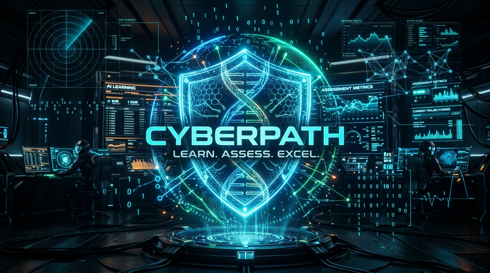

# 🛡️ CYBERPATH — AI-Powered Cybersecurity Learning, Assessment & Career Guidance Platform

<p align="center">
  
</p>

> **Smart India Hackathon 2026 (SIH 2026) — Problem Statement: SIH26101**  
> *An adaptive, diagnostic, AI-driven cybersecurity workforce acceleration platform built for India.*

<div align="center">

[](https://github.com/parvlabs/CyberPath)
[](CyberPath_SIH_Mentor_Judge_Defense_Guide.pdf)
[](CyberPath2/js/ai-config.js)
[](CyberPath2/js/i18n.js)

</div>

<table align="center" width="100%">
  <tr>
    <td width="65%" valign="top">
      <h3>🛡️ CyberPath Repository Card</h3>
      <p><b>An autonomous cybersecurity learning, assessment & career navigation ecosystem.</b> Transforms fragmented security education into personalized career acceleration through real-time competency diagnostics, mathematical role-gap analysis, and adaptive generative intelligence.</p>
      <p>
        <code>⚡ Zero-Dependency SPA</code> &bull;
        <code>🧬 48-Skill Cyber DNA</code> &bull;
        <code>🤖 5-Model Gemini Pool</code> &bull;
        <code>📝 Adaptive MCQs</code> &bull;
        <code>🇮🇳 Native English/Hindi</code>
      </p>
    </td>
    <td width="35%" valign="top" align="center">
      <h4>⚡ Quick Navigation</h4>
      <p>
        🌐 <a href="https://parvlabs.github.io/CyberPath/"><b>Live Web App ↗</b></a><br>
        📑 <a href="CyberPath_SIH_Mentor_Judge_Defense_Guide.pdf"><b>Judge Defense Guide (PDF)</b></a><br>
        📁 <a href="CyberPath2/"><b>App Source Code (14 Views)</b></a><br>
        🤖 <a href="CyberPath2/js/ai-config.js"><b>Gemini Client Engine</b></a>
      </p>
    </td>
  </tr>
</table>

---

## 🌟 Overview

**CyberPath** is an autonomous cybersecurity mentorship, competency assessment, and career navigation platform designed to bridge India's 1.5M+ cybersecurity talent deficit. Built as a high-performance Single Page Application (SPA), it operates **Local-First** with zero compulsory cloud dependencies, while providing hybrid cloud synchronization via Google Firebase and real-time generative intelligence via Google Gemini.

---

## 🚀 Key Features

* 🧬 **Cyber DNA Radar**: Visual multi-axis competency matrix mapping 48 granular security skills across 8 core domains.
* 📊 **Mathematical Skill Gap Engine**: Differential delta analysis evaluating user competency against 9 enterprise job profiles (SOC Analyst, Pentester, Cloud Security, DFIR, etc.).
* 🤖 **AI Career Advisor**: Context-aware multi-turn mentorship powered by a resilient 5-model Google Gemini failover pool (`gemini-3.5-flash-lite`, `gemini-3.5-flash`, etc.).
* 📝 **Adaptive Generative AI Quiz (SIH26101 Core)**: Generates 8 structured MCQs from arbitrary security text, URLs, or CVE reports, with dynamic streak-driven difficulty scaling.
* 📅 **Dynamic 4-Week Learning Planner**: Generates personalized daily study roadmaps prioritizing detected weak areas.
* 🛠️ **Build Lab (AI Project Blueprint Generator)**: Generates complete architectures and copy-pasteable GitHub READMEs for practical portfolio projects.
* 🌐 **Threat Intelligence & "Explain Simply"**: Live vulnerability disclosures simplified into beginner-friendly defensive takeaways.
* 🇮🇳 **Bilingual Multilingual Engine**: Seamless, instantaneous UI localization in **English** and **Hindi (हिन्दी)** with persistent user preferences.
* 🎮 **Gamification & Rewards**: 11 rank tiers (Novice &rarr; Cyber Legend), operational day streaks, and 20 unlockable security badges.

---

## 🛠️ Tech Stack

* **Frontend**: HTML5, Vanilla ES6+ JavaScript (18 modular files), Modern CSS3 Cyber-Dark Design System
* **AI Engine**: Google Gemini REST API with multi-model auto-failover pool
* **Persistence Layer**: Dual-mode storage (Local-First `LocalStorage` + Google Cloud Firestore)
* **Authentication**: Dual-mode (Local Guest Sandbox + Google Firebase OAuth)
* **Visuals**: Pure HTML5 2D Canvas & Dynamic SVG Radar charting (zero heavy chart libraries)

---

## 📁 Repository Structure

```
├── CyberPath2/                                    # Main Web Application Shell
│   ├── index.html                                 # Single Page Application entry (14 views)
│   ├── css/style.css                              # Cyber-Dark design system & animations
│   ├── assets/                                    # Logos, icons, and graphic assets
│   └── js/                                        # 18 Functional ES6 JavaScript modules
│       ├── ai-config.js                           # Gemini multi-model failover client
│       ├── ai-advisor.js                          # AI career mentorship chat
│       ├── ai-quiz.js                             # Generative MCQ synthesis engine
│       ├── dna.js                                 # Cyber DNA radar & 48-skill matrix
│       ├── skillgap.js                            # Role deficit mathematical calculations
│       ├── learning-plan.js                       # 4-week study plan generator
│       ├── project-gen.js                         # Build Lab project architecture generator
│       ├── i18n.js                                # English / Hindi bilingual engine
│       ├── firebase-config.js                     # FS local & cloud storage abstraction
│       ├── main.js                                # Router & gamification controller
│       └── ...
├── CyberPath_SIH_Mentor_Judge_Defense_Guide.pdf   # Complete SIH Judge Defense Manual
├── SIH_CyberPath_Judge_Defense_MasterGuide.html   # Publication-grade defense dossier HTML
└── README.md                                      # Project documentation
```

---

## 💻 Quickstart (Run Locally)

No Node.js compilation, npm installs, or complex dependencies required:

```bash
# 1. Clone this repository
git clone https://github.com/<YOUR_USERNAME>/CyberPath.git
cd CyberPath/CyberPath2

# 2. Run any static HTTP server (e.g. Python):
python -m http.server 3000

# 3. Open your browser:
# Navigate to http://localhost:3000
```

---

## 📄 Documentation

* **SIH Mentor & Judge Defense Guide**: See [`CyberPath_SIH_Mentor_Judge_Defense_Guide.pdf`](./CyberPath_SIH_Mentor_Judge_Defense_Guide.pdf) for the full 50+ question Q&A defense manual, live demonstration script, and architectural justifications.

---

## 👥 Team & Submission

* **Event**: Smart India Hackathon 2026 (SIH 2026)
* **Problem Statement**: SIH26101
* **Alignment**: National Cyber Workforce Readiness, NEP 2020, and iGOT Karmayogi Bharat
